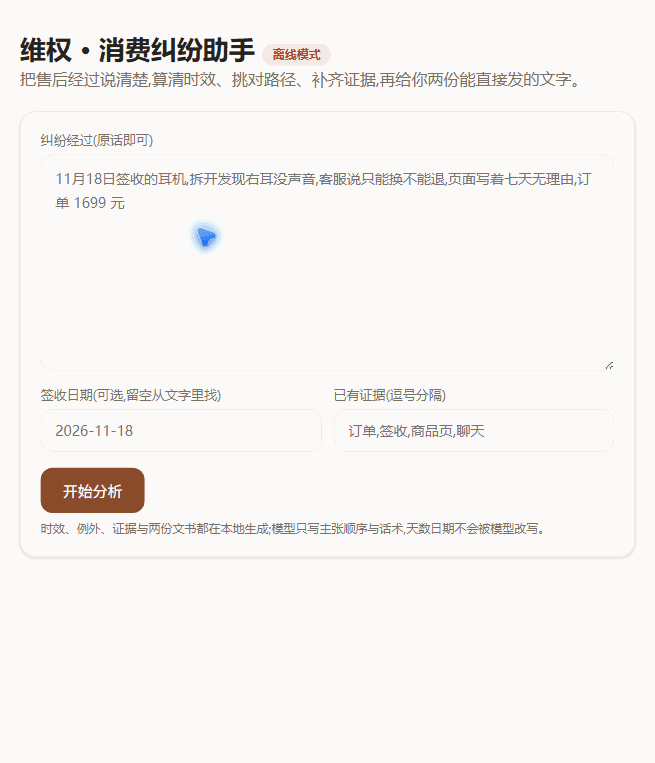
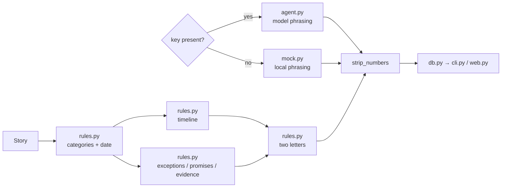

# WeiQuan · Consumer Rights Assistant

[](https://github.com/wushiyi105-jpg/weiquan/actions) []() [](./LICENSE) [](https://codecov.io/gh/wushiyi105-jpg/weiquan)



> Describe what went wrong with an order: count the days left, pick the right legal path, and get the complaint text and the first message to the seller.

Two things go wrong after buying something: **you don't know how many days you have left**, and **you say a lot without saying the thing that matters**. One "opened items cannot be returned" from a seller is enough to end the conversation — and the seventh day of the seven-day window is often today. This assistant computes the deadlines, exceptions, promises and evidence gaps locally, then tells you what to do and what to say, in order.

**CLI + Web, zero third-party dependencies.**

## ✨ Features

- 🧾 **Six legal paths** — no-reason return, three-pack repair/replace/refund, quality and counterfeit, false advertising, late shipping, prepaid cards, each with its legal basis and rights list
- ⏳ **Deadlines computed locally** — from the delivery date: no-reason window ends at `sign + 7`, three-pack gives `+7` return and `+15` replacement, with days remaining or days overdue
- 🚧 **Exceptions and deductions** — 7 exceptions (custom-made, fresh food, opened media, activated electronics, personal hygiene…) and 3 deductions (gift not returned, discount clawback, return shipping)
- 📢 **Promise extraction** — "ten times compensation", "three times", "no-questions returns", "lifetime warranty", "ships in 24h", each with whether it is actually enforceable
- 📎 **Evidence check** — 8 items, which are missing, why they matter, how to capture them
- 📄 **Two letters** — a 12315/platform complaint and the first message to the seller, each with facts, basis, demands and a deadline
- 🔒 **The model cannot change days or dates** — it writes only the order of steps and phrasing; "N days", "N yuan" and dates in its output are stripped, deadlines always come from the local calculation

## 🚀 Quick start

```bash
git clone https://github.com/wushiyi105-jpg/weiquan.git
cd weiquan

cp .env.example .env      # optional: LLM_API_KEY

python -m weiquan check --text "Headphones delivered on Nov 18, right earbud silent, seller says replacement only, page says 7-day no-reason return" --evidence "order,delivery"
```

Or keep the story in `case.txt` and run `python -m weiquan check --file case.txt --save`.

Docker (the image is built and pushed to GHCR on every tag):

```bash
docker pull ghcr.io/wushiyi105-jpg/weiquan:0.1.0
docker run -p 8000:8000 ghcr.io/wushiyi105-jpg/weiquan:0.1.0
```

Build locally with `docker build -t weiquan . && docker run -p 8000:8000 weiquan`.

## 🧪 Examples: run the real cases

`examples/` holds 4 anonymised real disputes (earphones, jacket, laptop, custom curtains); `examples/out/` holds the actual output of 2026-11-26 in offline mode. Days are counted from the run date, and the header of each output file records the command and the date.

```bash
python -m weiquan --mock check --file examples/case-01.txt --sign 2026-11-21 --evidence 订单,商品页,聊天记录
```

Output (verbatim Chinese output, full file at [`examples/out/case-01.md`](./examples/out/case-01.md)):

```
⏳ 时效
  签收日 2026-11-21,今天第 5 天
  · 「七天无理由退货」截止 2026-11-28,还剩 2 天
  · 「三包·7 日退货」截止 2026-11-28,还剩 2 天
  · 「三包·15 日换货」截止 2026-12-06,还剩 10 天
```

## 🤔 Why not just ask a general LLM

A general model will tell you "you can complain to 12315" and "keep your evidence". WeiQuan adds four things it cannot:

1. **The deadline is arithmetic** — `rules.timeline()` starts from the delivery date: `due = sign + timedelta(days=7)`, `remain = (due - today).days`. Delivered 11-18, today 11-25, it says "today is the last day" rather than "you probably still can". A model's date arithmetic is often one day off, and one day is the difference between a refund and a refusal.
2. **Statutes and exceptions are looked up, not generated** — six paths, 7 exceptions and 8 promise types live in `data/*.json`. A hard boundary like "custom-made items have no no-reason return" will not flip because of how you phrase the question.
3. **The letters have a fixed structure** — `platform_letter()` writes basis → delivery date and days → facts → promises → demands → evidence. That is what a complaint reviewer looks for; free-form model text tends to become an emotional essay that omits the demand.
4. **It works offline** — without a key you still get classification, deadlines, exceptions, evidence checks and both letters. Only the model-written phrasing is missing.

## 🎯 Use cases

- **Something is wrong on arrival**: enter the delivery date and the problem, see how many days the no-reason window has left, then decide between return and three-pack replacement — the two paths have different clocks.
- **The seller keeps stalling**: paste their exact words ("replacement only", "opened items cannot be returned"); the assistant shows the conflict with the product page promise and gives a reply you can send as-is.
- **You need to file a complaint**: use the generated 12315 text, add the order number and evidence list, and state facts and demands once instead of sending supplementary material back and forth.
- **Prepaid card, shop closed**: take the prepaid path and claim the unspent balance instead of just demanding "my money back".

## 🗺 Roadmap

- **Follow-up ledger**: record each contact, the reply and whether it escalated; compute how long it has been dragging and prompt the next step.
- **Platform rule pack**: entry points, deadlines and evidence requirements per marketplace, with a matching appeal template.
- **Amount computation**: refund amounts after gift and discount clawback, and the 500-yuan floor for treble damages — currently qualitative only.
- **Evidence bundle**: file screenshots by evidence item into one indexed PDF for a single upload.
- **Statute change alerts**: flag which basis changed after an amendment, so old clauses are not quoted.

## ❓ FAQ

**Do I need an API key?**
No: paths, deadlines, exceptions, promises, evidence and both letters are generated locally. Only the order of steps, phrasing and risks need a model; the default is DeepSeek (`https://api.deepseek.com`), set `LLM_API_KEY` in `.env` or pass `--api-key`.

**Where is data stored, is it uploaded?**
`data/weiquan.db` (override with `WEIQUAN_DB` or `--db`), holding category, delivery date, days, missing-evidence count and the detail JSON. Model calls send the story, categories, promises and evidence gaps — never the database.

**Will the model turn "3 days left" into "7 days left"?**
No. `agent.strip_numbers()` replaces days, dates, amounts and percentages in model output with a neutral phrase; deadline numbers come only from `rules.timeline()`.

**What if I don't know the delivery date?**
`2026-11-18`, `Nov 18`-style Chinese dates, and "yesterday" are supported. If none is found the tool asks for one, because both the no-reason window and the three-pack clock start at delivery.

**Can it file the complaint for me?**
It writes the text; you add the order number and seller name — the tool does not invent them. Check the facts before submitting.

## 📖 Commands

```bash
# ⚖️ analyse a case
python -m weiquan check --text "..." --evidence "order,delivery,product page"
python -m weiquan check --file case.txt --sign 2026-11-18 --save

# 📚 six paths
python -m weiquan rights

# 📎 evidence checklist
python -m weiquan evidence

# 🗂 history
python -m weiquan history

# 🌐 web
python -m weiquan web --port 8000

python -m weiquan --json check --text "..."   # raw JSON
python -m weiquan --mock check --text "..."   # force offline
```

## 🔌 Model configuration

Any **OpenAI-style `/chat/completions`** endpoint:

| Platform | `LLM_BASE_URL` | `LLM_MODEL` |
|---|---|---|
| DeepSeek (default) | `https://api.deepseek.com` | `deepseek-flash` |
| OpenAI | `https://api.openai.com/v1` | `gpt-4o-mini` |
| Local Ollama | `http://localhost:11434/v1` | `qwen2.5` |

## 🧠 How it works

```
story + delivery date
  │
  ├─ rules.classify ───── six paths by keyword
  ├─ rules.parse_date ─── ISO / month-day / yesterday
  ├─ rules.timeline ───── sign+7 / +15, remaining or overdue
  ├─ rules.exceptions ─── 7 exceptions + 3 deductions
  ├─ rules.promises ───── 8 promise types with their limits
  ├─ rules.evidence_check  which of 8 evidence items are missing
  ├─ rules.*_letter ───── 12315 text + first message to seller
  │
  ├─ model: steps, phrasing, risks (strip_numbers filter)
  └─ offline: mock.py assembles from categories and gaps
  │
  └─ SQLite → CLI / Web
```

### Data flow



## 🗂 Layout

```
weiquan/
├── weiquan/
│   ├── rules.py    # categories, deadlines, exceptions, promises, evidence, letters
│   ├── agent.py    # orchestration + number stripping
│   ├── mock.py     # offline steps and phrasing
│   ├── db.py       # local case records
│   ├── cli.py      # check / rights / evidence / history / web
│   └── web.py      # single page + JSON API
├── data/
│   ├── categories.json  # 6 paths
│   ├── exceptions.json  # 7 exceptions + 3 deductions
│   ├── promises.json    # 8 promise types
│   └── evidence.json    # 8 evidence items
├── examples/            # 4 anonymised disputes + out/ actual reports
├── tests/
│   ├── test_weiquan.py      # 29 local-logic tests
│   └── test_integration.py   # 8 integration tests (HTTP / fake model / CLI)
└── assets/demo.gif      # 655 px wide, 32 frames, 19.7 s
```

## ✅ Tests

```bash
python -m unittest discover tests -v
```

37 tests in two layers:

- **Local logic (29)**: classification, four date formats, remaining/overdue, both three-pack nodes, exceptions, promises, evidence, both letters, the stripping function and the offline pipeline.
- **Integration (8)**: a real `ThreadingHTTPServer` on a random port receiving `POST /api/check` and asserting the day count equals the local computation, both letters are present, an id is stored, and a future sign date returns 400; a fake OpenAI-compatible server asserting that "3 天", "1500 元" and "7 个工作日" written by the model are all replaced with 「相应期限」; `subprocess` CLI e2e asserting exit codes and stdout lines.

CI runs them on 3.10 / 3.11 / 3.12 and records coverage with codecov.

## 👤 Author

Xiao Mi · 17612850106

## 📄 License

[MIT](./LICENSE)
