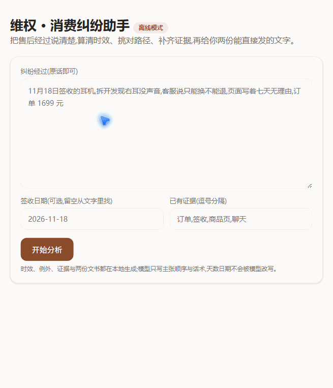
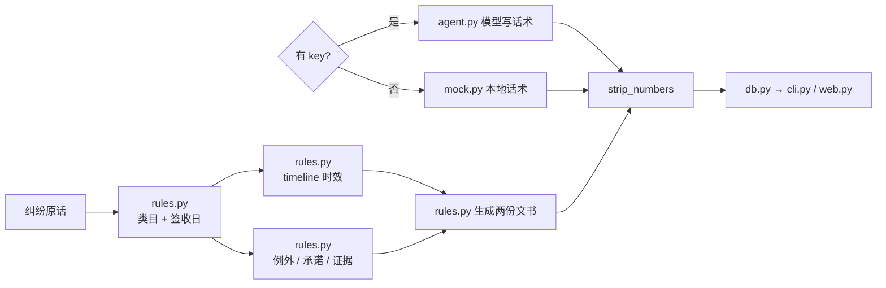

# 维权 · 消费纠纷助手

[](https://github.com/wushiyi105-jpg/weiquan/actions) []() [](./LICENSE) [](https://codecov.io/gh/wushiyi105-jpg/weiquan)



> 把售后经过说清楚:算清还剩几天、能不能退、该引哪条,再把投诉正文和给商家的第一段写好。

售后最怕两件事:**不知道自己还剩几天**,以及**说了一堆却没说到点上**。商家一句「已拆封影响二次销售」就能把人挡回来,而七天无理由的第七天往往就是今天。维权助手把时效、例外、承诺、证据全部在本机算清楚,再按顺序告诉你先做什么、说什么。

**CLI + Web,零第三方依赖。**

## ✨ 特性

- 🧾 **六类路径识别** — 七天无理由 / 三包 / 质量与假冒 / 虚假宣传 / 延迟发货 / 预付卡,每类挂法条依据与权利清单
- ⏳ **时效本地推算** — 从签收日算起:无理由截止 `签收日+7`,三包 `+7` 退货、`+15` 换货,剩余天数与超期天数直接给出
- 🚧 **例外与扣减** — 定制、生鲜、拆封音像、激活数码、贴身用品等 7 类例外;赠品未退、满减扣回、运费归属 3 类扣减
- 📢 **承诺抽取** — 假一赔十、退一赔三、包退包换、终身保修、24 小时发货等 8 类,附「能不能主张」的边界
- 📎 **证据体检** — 8 项证据逐项判定,缺哪项、为什么缺、怎么补
- 📄 **两份文书** — 12315/平台投诉正文 + 给商家的第一段,事实、依据、诉求、期限齐全
- 🔒 **天数与日期不许模型改** — 模型只写主张顺序与话术,输出里的「N 天」「N 元」「x月x日」一律剥掉,时效只认本地计算

## 🚀 快速开始

```bash
git clone https://github.com/wushiyi105-jpg/weiquan.git
cd weiquan

cp .env.example .env      # 可选:填 LLM_API_KEY

python -m weiquan check --text "11月18日签收的耳机,右耳没声音,客服说只能换不能退,页面写着七天无理由" --evidence "订单,签收"
```

把经过写进 `case.txt` 也可以:`python -m weiquan check --file case.txt --save`。

Docker(镜像由 CI 推到 GHCR,每次打 tag 自动构建):

```bash
docker pull ghcr.io/wushiyi105-jpg/weiquan:0.1.0
docker run -p 8000:8000 ghcr.io/wushiyi105-jpg/weiquan:0.1.0
```

自己构建:`docker build -t weiquan . && docker run -p 8000:8000 weiquan`。

## 🧪 示例:拿真实纠纷跑一遍

`examples/` 里 4 份脱敏过的真实经过(耳机、家电、生鲜、预付卡),`examples/out/` 是对应的实际输出(2026-11-26 跑出,离线模式,天数以当天为基准)。

```bash
python -m weiquan --mock check --file examples/case-01.txt --sign 2026-11-21 --evidence 订单,商品页,聊天记录
```

跑出来是这样(节选,完整见 [`examples/out/case-01.md`](./examples/out/case-01.md)):

```
⏳ 时效
  签收日 2026-11-21,今天第 5 天
  · 「七天无理由退货」截止 2026-11-28,还剩 2 天
  · 「三包·7 日退货」截止 2026-11-28,还剩 2 天
  · 「三包·15 日换货」截止 2026-12-06,还剩 10 天

📎 证据体检
  ✅ 订单与支付记录
  ✅ 签收时间证明
  ❌ 破损/故障影像 —— 质量问题需证明瑕疵存在与到货即损坏
```

> 天数会随运行日期变化,输出文件头部写明了生成命令与运行日期,可对着同一天复算。

| 文件 | 场景 | 关注点 |
|---|---|---|
| `case-01.txt` | 耳机右耳无声,页面写七天无理由 | 无理由 vs 三包两条路,剩 2 天 |
| `case-02.txt` | 羽绒服色差,客服称「超过七天」 | 时效抗辩、标签未拆 |
| `case-03.txt` | 笔记本标「全新未拆封」实为翻新机 | 假一赔十、检测报告 |
| `case-04.txt` | 定制窗帘尺寸做错 + 赠品缺失 | 定制例外、赠品扣减 |

## 🤔 为什么不用通用大模型直接问

通用模型能告诉你「可以投诉 12315」「保留证据」。它给不了这四样:

1. **时效是算出来的** — `rules.timeline()` 以签收日为起点:`due = sign + timedelta(days=7)`,`remain = (due - today).days`。签收 11-18、今天 11-25,它会明确告诉你「今天是最后一天」,不是「大概还能退」。模型算日期经常差一天,而差一天就是退不了。
2. **法条与例外是查表,不是生成** — 六类路径、7 条例外、8 类承诺都写在 `data/*.json` 里,「定制不适用无理由」这种硬边界不会因为提问方式被模型说反。哪些能主张、哪些只是商家口号,表里写清楚了。
3. **文书结构固定** — `platform_letter()` 按「事由 → 签收日与天数 → 事实 → 承诺 → 诉求 → 附证据」生成,12315 受理看的就是这几段。让模型自由写,容易写成情绪长文,反而漏掉诉求。
4. **断网也能用** — 没有 key 时,识别、时效、例外、证据、两份文书全都在,只少模型写的话术。真到要投诉的时候,你未必有心情折腾 API。

## 🎯 适用场景

- **刚收到就有问题**:签收当天把日期和问题写进去,先看无理由还剩几天,再决定是退货还是走三包换货 —— 两条路的时限不一样,别用错。
- **客服一直拖**:把聊天里的「只能换不能退」「已拆封不退」原话贴进来,系统会指出这与页面承诺冲突,并给出可直接发送的回应。
- **要写投诉但不知道写什么**:用生成的 12315 正文,补上订单号与证据清单,一次说清事实与诉求,不用来回补材料。
- **预付卡/门店关门**:走预付卡路径,按未消费余额主张退款,而不是只喊「退钱」。

## 🗺 Roadmap

- **多轮跟进台账**:同一单记录每次沟通时间、对方答复、是否升级,自动算「已拖几天」并提醒下一步。
- **平台规则库**:按淘宝/京东/拼多多/抖音各写一套介入入口、时效与举证要求,输出对应平台的申诉模板。
- **金额与比例计算**:退款金额(扣赠品、按比例扣满减)、退一赔三的 500 元下限,全部本地算,现在只做定性。
- **证据打包**:把截图按证据项归档成一份带目录的 PDF,投诉时一次上传。
- **法条更新提示**:法规修订后提示哪条依据变了,避免引用过时条款。

## ❓ FAQ

**要 API key 吗?**
不要也能用:路径、时效、例外、承诺、证据、两份文书全部本地生成。只有「主张顺序 / 话术 / 风险」这三块需要模型;默认 DeepSeek(`https://api.deepseek.com`),在 `.env` 填 `LLM_API_KEY` 或 `--api-key`。

**数据存在哪,会上传吗?**
`data/weiquan.db`(可用 `WEIQUAN_DB` 或 `--db` 改),存类目、签收日、天数、缺证据数与明细 JSON。调模型时只发纠纷描述、类目、承诺与证据缺口,不发数据库。

**模型会不会把「还剩 3 天」写成「还剩 7 天」?**
不会。`agent.strip_numbers()` 会把模型输出里的天数、日期、金额、比例统一替换成「相应期限」;时效数字只来自 `rules.timeline()` 的本地计算。

**签收日期没写怎么办?**
支持 `2026-11-18`、`11月18日`、`昨天/前天`;都找不到时会提示补日期,因为无理由与三包都从签收起算,没有日期算不出时效。

**能直接生成投诉吗?**
可以,但正文里的订单号、商家名称要你自己补,系统不编造。文书已包含诉求段与法条,提交前核对事实即可。

## 📖 命令参考

```bash
# ⚖️ 分析一单
python -m weiquan check --text "..." --evidence "订单,签收,商品页"
python -m weiquan check --file case.txt --sign 2026-11-18 --save

# 📚 六类路径
python -m weiquan rights

# 📎 证据清单
python -m weiquan evidence

# 🗂 历史记录
python -m weiquan history

# 🌐 Web
python -m weiquan web --port 8000

python -m weiquan --json check --text "..."   # 原始 JSON
python -m weiquan --mock check --text "..."   # 强制离线
```

## 🔌 模型接入

任何兼容 **OpenAI `/chat/completions`** 的服务:

| 平台 | `LLM_BASE_URL` | `LLM_MODEL` |
|---|---|---|
| DeepSeek(默认) | `https://api.deepseek.com` | `deepseek-flash` |
| OpenAI | `https://api.openai.com/v1` | `gpt-4o-mini` |
| 本地 Ollama | `http://localhost:11434/v1` | `qwen2.5` |

## 🧠 工作原理

```
纠纷原话 + 签收日期
  │
  ├─ rules.classify ───── 六类路径关键词命中
  ├─ rules.parse_date ─── 抽签收日(ISO / 月日 / 昨天前天)
  ├─ rules.timeline ───── 签收+7 / +15,剩几天、超几天
  ├─ rules.exceptions ─── 7 条例外 + 3 类扣减
  ├─ rules.promises ───── 8 类商家承诺与原话
  ├─ rules.evidence_check  8 项证据缺哪项
  ├─ rules.*_letter ───── 12315 正文 + 商家第一段
  │
  ├─ 模型:主张顺序 / 话术 / 风险(strip_numbers 过滤)
  └─ 离线:mock.py 按类目、例外、证据缺口组装
  │
  └─ SQLite → CLI / Web
```

### 数据流



## 🗂 目录结构

```
weiquan/
├── weiquan/
│   ├── rules.py    # 类目、时效、例外、承诺、证据、文书
│   ├── agent.py    # 编排 + 天数/日期/金额剥离
│   ├── mock.py     # 离线主张顺序与话术
│   ├── db.py       # 本地记录
│   ├── cli.py      # check / rights / evidence / history / web
│   └── web.py      # 单页 + JSON API
├── data/
│   ├── categories.json  # 6 类路径
│   ├── exceptions.json  # 7 条例外 + 3 类扣减
│   ├── promises.json    # 8 类承诺
│   └── evidence.json    # 8 项证据
├── examples/            # 4 份脱敏经过 + out/ 实际输出
├── tests/
│   ├── test_weiquan.py      # 29 个本地逻辑用例
│   └── test_integration.py   # 8 个集成用例(HTTP / 假模型 / CLI)
└── assets/demo.gif      # 655 宽,32 帧,19.7 秒
```

## ✅ 测试

```bash
python -m unittest discover tests -v
```

37 个用例分两层:

- **本地逻辑(29)**:类目识别、四种日期写法、剩余/超期、三包双节点、例外、承诺、证据、两份文书、剥离函数、离线全流程。
- **集成(8)**:真起 `ThreadingHTTPServer` 在随机端口 `POST /api/check`,断言天数等于本地计算、两份文书齐、落库 id 非空,未来签收日返回 400;起假 OpenAI 兼容服务,断言模型写的「还剩 3 天」「1500 元」「7 个工作日」全被 `strip_numbers` 换成「相应期限」;`subprocess` 跑 CLI,e2e 断言退出码与 stdout 关键行。

CI 在 3.10 / 3.11 / 3.12 上跑,并用 codecov 记录覆盖率。

## 👤 作者

小米 · 17612850106

## 📄 License

[MIT](./LICENSE)
